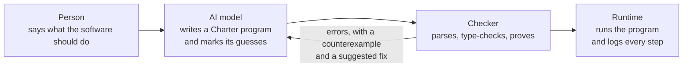

# The Charter Experiment

Charter is a programming language for software that an AI writes and a machine checks. This repository is the experiment that tests whether that idea works. It holds the language's design, a working toolchain, and the benchmark that will measure Charter against TypeScript.

A person describes what the software should do in plain words. An AI turns that into a small, typed, formal program. Deterministic tools then check that program, prove what they can about it, and run it. No AI model is involved at runtime.

**State on November 9, 2026:** the tools that check and run Charter programs are built and tested (milestones 0 to 2). The first experiment that tests whether the idea works, the H1 pilot, is ready but has not been run. Nothing about Charter's benefits has been measured yet.

## Contents

- [What Charter is](#what-charter-is)
- [A complete program](#a-complete-program)
- [How it works](#how-it-works)
- [Why we would use it](#why-we-would-use-it)
- [Status](#status)
- [Quick start](#quick-start)
- [Commands](#commands)
- [The HTTP interface](#the-http-interface)
- [The language in brief](#the-language-in-brief)
- [The H1 pilot](#the-h1-pilot)
- [Repository layout](#repository-layout)
- [Development](#development)
- [Documentation](#documentation)
- [What Charter gives up](#what-charter-gives-up)
- [License](#license)

## What Charter is

A Charter program is a written statement of the rules of a piece of software. It says five things:

| The program states | Charter word | Example from a to-do app |
|---|---|---|
| What data is stored | `entity` | A task has an owner, a title, an optional due date and a done flag. |
| Who may do what | `permission` | A person owns a task if they are its owner. |
| Which actions exist, and what each one changes | `rule` | Completing a task is allowed only for its owner, only if it is not already done, and sets the done flag. |
| What must always be true | `invariant` | A store-credit balance is never negative. |
| What the software is for, and whether a person agreed to it | `requirement` | "Each person sees and changes only their own tasks." Confirmed. |

Charter is aimed at software that is mostly data, rules and permissions: business applications, web services, workflows and game servers. In that kind of software, most bugs are broken rules, not broken algorithms. It is the wrong tool for heavy computation, device drivers or game engines.

Very little of Charter is invented. Transactions come from databases, guarded rules from formal modelling languages, automatic proofs from verification tools, and deny-by-default permissions from policy languages. What is new is the combination, plus three additions: requirements live inside the program, the grammar is small enough that an AI's output can be held to it, and AI edits are meant to be small, typed changes instead of free rewrites of text.

## A complete program

This is a whole Charter program, unchanged from [bench/tasks/p12-store-credit/reference.charter](bench/tasks/p12-store-credit/reference.charter). It keeps a store-credit balance for each person.

```
module credit@0.1.0
principal Person

entity Person { name: Text, balance: Int where >= 0 = 0 }
enum CreditError { InsufficientCredit }

rule Register(name: Text where len(trim(it)) >= 1): Id<Person>
  permit system
  create Person { name = name } as p
  return p.id

rule Grant(customer: Person, cents: Int where it >= 1 and it <= 100000): Int
  permit system
  set customer.balance = customer.balance + cents
  return customer.balance

rule Spend(cents: Int where >= 1): Int rejects CreditError
  permit anyone
  let me = caller
  guard me.balance >= cents else reject InsufficientCredit
  set me.balance = me.balance - cents
  return me.balance

query Balance(): Int permit anyone = caller.balance

invariant NeverNegative: Person.balance >= 0
```

| Line | What it means |
|---|---|
| `principal Person` | The people who sign in are `Person` records. Inside a rule, `caller` is the person making the request. |
| `balance: Int where >= 0 = 0` | A balance is a whole number that is never below zero, and starts at zero. The limit is part of the type, so it applies everywhere. |
| `permit system` | Only the operator may register people or grant credit. Anything not permitted is denied. |
| `cents: Int where it >= 1 and it <= 100000` | A grant must be between 1 and 100,000 cents. A call outside that range is rejected before the rule runs. |
| `guard … else reject InsufficientCredit` | Spending more than the balance is refused with a named reason, and nothing changes. |
| `query Balance()` | A query reads data and can never change it. |
| `invariant NeverNegative` | No rule, present or future, may leave any balance below zero. This is checked at every commit. |

Running it gives these outcomes (ids differ on each run):

```
Register "Ana"            → Ok  Person#fecc6d4b5024e977
Grant Ana 500             → Ok  500
Spend 200, as Ana         → Ok  300
Spend 1000, as Ana        → Rejected  InsufficientCredit
Spend 0, as Ana           → Rejected  ValidationError(cents)
Grant Ana 5, as Ana       → Rejected  Denied
Balance, as Ana           → Ok  300
```

## How it works



The model is the only part that uses AI. The checker and the runtime are ordinary programs: the same input gives the same result every time. The checker and runtime are built. The command that connects a person's words to a model, `charter ask`, is planned for milestone 7; today the model step is driven by the test harness in [bench/](bench/README.md).

### One rule call is one step

Rules are the only way to change stored data. Every call to a rule is one step, and every step goes through the same sequence:

1. **Inputs.** Is each argument within its type's limits? If not: `ValidationError`.
2. **Permission.** Is the caller allowed? If not: `Denied`.
3. **Guards.** Do the rule's conditions hold? If not: the named rejection.
4. **Invariants.** Are they all still true after the change?
5. **Commit.** All changes are saved at once.

If any check fails, the step is rejected with a named reason and the data is left exactly as it was. Every step, accepted or rejected, goes into the step log. Replaying the log on an empty database must reproduce every outcome and the exact final state, and `charter replay` checks that it does.

### The checker refuses programs it cannot trust

`charter check` parses the program against the grammar, checks every name and type, and then tries to prove that certain errors cannot happen. For the store-credit program it reports:

```
✓ parsed (1 module, 8 declarations)
✓ names and types
✓ proof obligations: 1 proven, 1 kept as runtime checks
    proven         me.balance - cents stays within the Int range  (line 21)
    runtime check  customer.balance + cents stays within the Int range  (line 14)
ℹ line 26: Invariant proofs (invariants are checked at every commit now; proving them arrives in milestone 3)
```

When it cannot prove something that matters, it refuses the program and shows an input that breaks it. Here a calculator divides without first checking the divisor:

```
error CH0401  cannot prove that b is not zero
    known: nothing
    counterexample: b = 0
    fix (add_guard): check the divisor first, for example: if b == 0 then … else …
```

The message names the problem, gives a concrete failing case and suggests the kind of fix, so a model can repair its program without guessing.

### Requirements are part of the program

Each requirement is a line in the program with a status. `confirmed` means a person asked for it. `inferred` means the AI filled a gap with a guess. Code points back to the requirement it serves with `req R-5`, and the checker lists every guess that nobody has approved:

```
requirement R-5 confirmed "Each person sees and changes only their own tasks."
requirement R-7 inferred  "Done tasks cannot be reopened."
```

```
⚠ 4 requirement(s) not confirmed: R-6 (inferred), R-7 (inferred), R-8 (inferred), R-10 (inferred). A release build is blocked until a person confirms them.
```

Today this is only a warning. There is no release build yet, no command for confirming a requirement, and nothing stops an AI from marking its own guess as confirmed.

## Why we would use it

Each part of the design answers a specific way that AI-written software goes wrong.

| Problem today | What Charter does about it | State |
|---|---|---|
| The AI writes code that does not compile, or is subtly wrong. | The language is small (83 grammar productions) and regular, its words are borrowed from TypeScript and SQL, and every program has one canonical layout. | Built, benefit unproven |
| A check is forgotten in one of the many places that change data. | Data changes only through rules. Every rule call passes permission, guards and invariants, and an invariant is written once and applies to every rule. | Built |
| Bugs are found only when the software is running. | The checker proves that some errors cannot happen, and refuses the program with a counterexample when it cannot. | Partly built: division by zero and type limits are proven now; invariants are checked at every commit and will be proven in milestone 3 |
| The AI guesses what you meant and you never find out. | Guesses are marked `inferred` and listed by the checker. | Partly built: reported now, not yet enforced |
| An AI in a running system is unpredictable and hard to audit. | No AI runs in production. Every step is logged and can be replayed. | Built |
| A small change request breaks something unrelated. | AI edits are meant to be small, typed changes to one part of the program, each with a report of what else is affected. | Planned (milestone 6) |

### The four claims, and how they will be tested

The design rests on four hypotheses. Each has a bar to clear against TypeScript, with the same models, tasks and budget.

| | Claim | Bar to clear |
|---|---|---|
| H1 | AI models write valid programs more often in a small, strict language. | Valid on the first try at least 15 points more often than TypeScript, and passing hidden tests at least as often. |
| H2 | Structured edits cause fewer accidental changes than editing text. | At least 50% fewer unrelated behaviours changed per request. |
| H3 | Writing rules, permissions and invariants directly catches more mistakes before running. | At least twice as many seeded mistakes caught as strict TypeScript with a linter. |
| H4 | Reading the program back in plain words lets people spot a misunderstanding faster. | More misreadings spotted, in less time, than by reading generated TypeScript. |

**None of these has been measured.** Charter is a well-specified bet with working tools, not a proven result. The design says that Charter fails as an AI-native language if H1 and H2 both fail, even if H3 passes.

## Status

| Milestone | State |
|---|---|
| 0. Foundations | Done. Repository, layer rule, frozen grammar, conformance corpus, CI. |
| 1. Calculator end to end | Done. Parser, printer, hashes, name resolution, type checker, Z3 proofs, interpreter, tests. |
| 2. State, and readiness for the H1 pilot | Done, except the pilot run. Rules as transactions on SQLite, invariants at every commit, step log and replay, `charter serve`, the grammar frozen and exported for constrained decoding. |
| Gate: H1 pilot | Harness built and tested; pilot not run. The project owner has reviewed the 22 tasks; that review is not independent. Waiting on model access and a budget. See [The H1 pilot](#the-h1-pilot). |
| 3. Verifier | Planned. Proving invariants and asserts ahead of time. |
| 4. Effects | Planned. Payments, email and other outside effects, with an outbox and a dispatcher. |
| 5. Compiler | Planned. Charter IR, and TypeScript and SQL generation. |
| 6. Change management | Planned. Structured edits, impact reports, migrations. |
| 7. Language bridge and explanations | Planned. `charter ask`, the repair loop, plain-language read-back. |
| 8. Full evaluation | Planned. The studies for H1 to H4. |
| 9. Language server and web IDE | Planned. |

The full plan is in the design document, section 8.5.

| Working now | Not built yet |
|---|---|
| The grammar, frozen, with 27 recorded amendments | Proving invariants and asserts ahead of time (milestone 3) |
| Parser and canonical formatter | Outside effects: they are queued in the outbox but not dispatched (milestone 4) |
| Name and type checker, with refinement types | A compiler: programs run on the reference interpreter (milestone 5) |
| Z3 proofs for division by zero, refinements and numeric ranges | Structured AI edits with impact reports (milestone 6) |
| Entities stored in SQLite, one transaction per rule call | `charter ask`, the plain-language interface (milestone 7) |
| Permissions, guards and invariants checked on every step | A release build that refuses unconfirmed requirements |
| Events and triggers | Sign-in: `charter serve` trusts a development-only header |
| Tests and randomised property tests inside the program | |
| Any program served over HTTP (`charter serve`) | |
| Step log and replay | |

## Quick start

You need **Node 22.18 or later**. The `charter` command runs TypeScript directly, so there is no build step. Run every command from the repository root.

```bash
git clone https://github.com/adaPlu/Charter.git
```

```bash
cd Charter
```

```bash
npx pnpm@9.15.4 install
```

Every command can be written `npm run charter -- <command> …` or `node packages/cli/src/main.ts <command> …`. The examples below use the first form.

### Check a program

```bash
npm run charter -- check conformance/cases/c001-calculator/input.charter
```

```
✓ parsed (1 module, 15 declarations)
✓ names and types
✓ proof obligations: 1 proven, 4 kept as runtime checks
    proven         b is not zero  (line 20)
    runtime check  a + b stays within the Decimal range  (line 17)
    runtime check  a - b stays within the Decimal range  (line 18)
    runtime check  a * b stays within the Decimal range  (line 19)
    runtime check  a / b stays within the Decimal range  (line 20)
⚠ 3 requirement(s) not confirmed: R-3 (inferred), R-4 (inferred), R-5 (inferred). A release build is blocked until a person confirms them.
```

The design predicted that two of those range checks would be proven. They are not, because `calculate` takes plain `Decimal` parameters, so its inputs have no bounds. The [errata](docs/design/10-errata.md) record this and the other findings that contradicted the design.

See the checker refuse a program that divides without checking the divisor. The command exits with status 1:

```bash
npm run charter -- check conformance/cases/n005-division-unproven/input.charter
```

```
✗ proof obligations: 0 proven, 4 kept as runtime checks, 1 unproven
…
conformance/cases/n005-division-unproven/input.charter:12:20  error CH0401  cannot prove that b is not zero
    known: nothing
    counterexample: b = 0
    fix (add_guard): check the divisor first, for example: if b == 0 then … else …
```

### Run the tests written inside a program

```bash
npm run charter -- test examples/todo/todo.charter
```

```
✓ someone else cannot complete my task
✓ completing twice is rejected
✓ property: a list never shows another person's tasks (1,000 cases)
3 passed, 0 failed, 0 skipped
```

### Call rules and queries

Each argument is a Charter expression, so text needs its own double quotes and an absent optional value is `none`. `--system` runs the call as the operator, `--as <id>` runs it as a signed-in caller, and `--db` names the SQLite file that holds the data. Without `--db` the data is gone when the command ends.

```bash
npm run charter -- run conformance/cases/c001-calculator/input.charter Calculate 6 4 Div
```

```
Ok  Value(1.5)
```

A session with the to-do app, [examples/todo/todo.charter](examples/todo/todo.charter). The id to pass is the part after `#`:

```bash
npm run charter -- run examples/todo/todo.charter Register '"Ana"' --system --db todo.db
```

```
Ok  User#98036220f982dd2c
```

```bash
npm run charter -- run examples/todo/todo.charter AddTask '"Buy milk"' none --as 98036220f982dd2c --db todo.db
```

```
Ok  Task#d97d36a181adea7f
```

```bash
npm run charter -- run examples/todo/todo.charter CompleteTask '"d97d36a181adea7f"' --as 98036220f982dd2c --db todo.db
```

```
Ok  none
```

The same call a second time gives `Rejected  AlreadyDone`. From a different user it gives `Rejected  Denied`. A blank title gives `Rejected  ValidationError(title)`.

```bash
npm run charter -- run examples/todo/todo.charter MyTasks --as 98036220f982dd2c --db todo.db
```

```
Ok  [{ id = Task#d97d36a181adea7f, title = "Buy milk", due = none, done = true }]
```

**On Windows PowerShell 5.1,** escape the inner quotes of a text argument, or PowerShell removes them and the checker reports `✗ "Ana" has no value here`:

```powershell
npm run charter -- run examples/todo/todo.charter Register '\"Ana\"' --system --db todo.db
```

### Serve it over HTTP

```bash
npm run charter -- serve examples/todo/todo.charter --db todo.db --port 8080
```

```bash
curl -s -X POST localhost:8080/rules/AddTask -H "x-charter-caller: 98036220f982dd2c" -d '{"args": ["Walk dog", null]}'
```

```json
{"outcome":"ok","value":"0575b5eaad573efa"}
```

```bash
curl -s -X POST localhost:8080/queries/MyTasks -H "x-charter-caller: 98036220f982dd2c" -d '{"args": []}'
```

```json
{"outcome":"ok","value":[{"id":"d97d36a181adea7f","title":"Buy milk","due":null,"done":true},{"id":"0575b5eaad573efa","title":"Walk dog","due":null,"done":false}]}
```

### Replay the history

```bash
npm run charter -- replay examples/todo/todo.charter --db todo.db
```

```
✓ replayed 9 logged step(s) on an empty store
✓ state hash matches: 9b8ba9b833717e7a…
```

## Commands

| Command | What it does |
|---|---|
| `charter check <file>` | Parse, check names and types, prove obligations with Z3 |
| `charter test <file> [--runs N]` | Run tests and properties, each on a fresh in-memory store |
| `charter run <file> <Name> [args] [--db F] [--as ID] [--system]` | Call a rule or query. Each argument is a Charter expression. |
| `charter serve <file> [--db F] [--port N]` | Every rule and query over HTTP. Development only. |
| `charter replay <file> --db F` | Re-run the step log on an empty store and compare the state hash |
| `charter fmt <file> [--check \| --write]` | Print the canonical form. `--write` refuses to delete comments unless you add `--force`. |
| `charter ask "<request>"` | Natural-language interface, planned for milestone 7. The only command that needs a model. |

## The HTTP interface

`charter serve` exposes every rule at `POST /rules/<Name>` and every query at `POST /queries/<Name>`. The body is `{"args": [...]}`, with arguments in the order the program declares them. `GET /schema` describes the rules and queries.

| Outcome | Status | Body |
|---|---|---|
| Accepted | 200 | `{"outcome":"ok","value":…}` |
| `ValidationError` | 400 | `{"outcome":"rejected","reason":"ValidationError",…}` |
| `Denied` on a rule | 403 | `{"outcome":"rejected","reason":"Denied"}` |
| `NotFound`, or `Denied` on a query | 404 | A refused query does not reveal that the record exists. |
| A rejection the program declares, such as `AlreadyDone` | 409 | `{"outcome":"rejected","reason":"AlreadyDone"}` |
| A fault or a broken invariant | 500 | A bug in the program, never a client mistake. |

The caller comes from the `X-Charter-Caller` header, with no authentication. That is for development only. Real sign-in belongs to the identity module ([libs/identity](libs/identity/README.md)), which is planned.

## The language in brief

A program is one module made of declarations. The one-page manual that models are given is [bench/manual/charter.md](bench/manual/charter.md); the grammar is [spec/charter.ebnf](spec/charter.ebnf).

| Declaration | Purpose |
|---|---|
| `module name@version` | Names the program. |
| `principal E` | The entity that signed-in callers are. `caller` is that record. |
| `requirement R-n confirmed\|inferred\|open "…"` | What the software is for, and whether a person agreed. Code links to it with `req R-n`. |
| `entity E { field: Type = default, … }` | A stored record. Every entity has an `id`. |
| `type T = … where …` | A named type, optionally restricted by a refinement. |
| `enum E { A, B(v: Int) }` | A set of variants, which may carry data. Also used for rejection reasons. |
| `permission P(u: User, x: E) = …` | A named condition for use in `permit`. |
| `rule R(params): T rejects E` | An action that changes data. Exactly one `permit`, then `let`, `guard … else reject`, `create`, `set`, `delete`, `for`, `if`, `return`. |
| `query Q(params): T permit … = …` | Reads data. `select … for x in E where … order by …`, `count`, `sum`, `exists`, `forall`. |
| `fn f(params): T = …` | A pure function of its arguments. It cannot read stored data, `caller` or `now` (error CH0231). It may call itself, at most 250 calls deep. |
| `invariant I: …` | A condition on stored data that must hold after every step. |
| `event E(params)` and `on E(x) do R(x)` | An event, and a trigger that calls a rule when it happens. |
| `assert A: …` | A claim about the program, such as "only the owner can complete a task". Type-checked now; proven from milestone 3. |
| `test "…" { given … when … expect … then … }` | An example test, run on a fresh store. |
| `property "…" forall x: T { … }` | A test run on many generated inputs (1,000 by default), shaped by the types' refinements. |

Types are `Int`, `Bool`, `Text`, `Decimal`, `Money`, `Time`, `Id<E>`, `List<T>`, optional `T?` (whose empty value is `none`), records and enums. A refinement restricts a type, as in `Int where >= 0` or `Text where len(trim(it)) >= 1`. On a field it must hold after every change. On a parameter, a call that breaks it is rejected with `ValidationError`.

`permit` takes one of four forms: `permit anyone` (any signed-in caller), `permit public` (signed in or not), `permit system` (the operator only), or `permit <condition>`. Anything not permitted is denied.

## The H1 pilot

The pilot is a small first test of H1, and it is allowed to stop the project. A model is given the same task in Charter and in TypeScript. Its program is checked with each language's real tool (`charter check` or `tsc --strict`), given up to three chances to repair itself from the diagnostics, then run against hidden black-box tests over HTTP. **If Charter's valid-on-first-try gain is under 5 points and its programs pass fewer hidden tests, development stops for a design review.**

| Piece | State |
|---|---|
| Harness | Built and tested, including a trial run with a small local model. Backends: mock, Ollama, llama.cpp, Anthropic. |
| Tasks | 22 tasks in 6 families, 88 test scenarios (22 shown to the model as examples, 66 hidden). The task packet is frozen. |
| Task review | The tasks were drafted with AI help. The project owner reviewed and approved all 22 on November 9, 2026. **That review is not independent:** the owner worked on Charter's design and has seen solutions, so Phase 7's requirement is not met, and a pilot run on these tasks must say so in its report. Records: [docs/pilot/owner-review-2026-11-09.md](docs/pilot/owner-review-2026-11-09.md) and, separately, the AI pre-review in [docs/pilot/ai-prereview-2026-11-09.md](docs/pilot/ai-prereview-2026-11-09.md). |
| Reference answers | TypeScript passes all 22 tasks. Charter passes 19 of 22; the three gaps (p10, p19, p20) are limits of the language, recorded in [bench/README.md](bench/README.md) and the errata. |
| Still needed | Access to the models (for example an Anthropic API key) and a budget, estimated at $15 to $40 for two models. A calibration run on one task, for about $1, would give real numbers first. An independent review of the tasks is still worth adding. |

**The tasks are public.** This repository was made public on November 9, 2026, and it contains every task, every hidden test and both sets of reference answers. "Hidden" means hidden from the model's prompt, not secret. The tasks carry no canary strings and there is no private held-out set, both of which the design (Phase 7) asks for. A model whose training data or tools could reach this repository may have seen the answers, so a pilot result is only valid for models trained before that date and run without web access, and the report must name the models and say so. The full evaluation (milestone 8) needs new tasks with a private held-out set.

The pilot can only compare free decoding for now. Holding a model's output to the grammar needs a llama.cpp server, and no TypeScript grammar exists for the other side. [bench/README.md](bench/README.md) lists every deviation from the design, the commands, and the cost estimate.

Check the harness and the reference answers with no model and no cost:

```bash
node bench/harness/run.ts --backend mock --arms B --pilot --repairs 0 --out bench/results/pilot-ts-reference
```

```bash
node bench/harness/run.ts --backend mock --arms C --pilot --repairs 0 --out bench/results/pilot-charter-reference
```

## Repository layout

| Path | Contents |
|---|---|
| `spec/` | The grammar (`charter.ebnf`), its lock, the amendments, the grammar exported for constrained decoders (`charter.gbnf`), pointers to the semantics |
| `packages/` | The 17 toolchain packages, listed below |
| `libs/identity/` | The identity module. A placeholder for now. |
| `examples/` | Runnable programs. `examples/todo/todo.charter` is the to-do app. |
| `conformance/cases/` | 21 programs with their expected parse, check, proof and test results |
| `bench/` | The H1 pilot: harness, tasks, reference answers, the review packet, results |
| `scripts/` | The layer rule, grammar tools, the corpus checker, generators |
| `docs/design/` | The design document, one file per phase, plus the errata |
| `docs/charter-design.md` | The combined design document, generated from `docs/design/` |
| `docs/overview/` | A 7-page overview as a PDF, with its HTML source |
| `docs/pilot/` | Records of the task reviews |
| `.github/workflows/ci.yml` | CI on Linux and Windows |

### Packages

[scripts/layers.mjs](scripts/layers.mjs) lists which packages each package may import, and `scripts/check-layers.mjs` enforces it. Only `llm` may talk to a model, only `intent` may import `llm`, and `cli` reaches `intent` only through the `ask` command. Every other command is guaranteed to run with no model.

| Package | Milestone | What it is | State |
|---|---|---|---|
| `syntax` | 1 | Lexer, parser, canonical printer, diagnostics, spans | Built |
| `graph` | 1 | Node schema, anchors, canonical CBOR, hashes | Built |
| `resolve` | 1 | Name resolution, behavioural dependency graph | Built |
| `types` | 1 | Type and effect checker, narrowing, refinement obligations | Built |
| `verify` | 3 | SMT encoding, Z3 bridge, proof cache | Built for refinement obligations; invariant proofs come in milestone 3 |
| `store` | 2 | SQLite store, single-writer queue, snapshots, migration runner | Built |
| `interp` | 1 | Reference interpreter, step log, replay | Built |
| `testing` | 1 | Test and property runner | Built |
| `cli` | 1 | The `charter` command | Built |
| `effects` | 4 | Capability registry, outbox, dispatcher | Placeholder |
| `runtime-ts` | 5 | Library used by generated apps: transactions, outbox, auth hook | Placeholder |
| `cir` | 5 | Charter IR, lowering, optimizer passes | Placeholder |
| `codegen-ts` | 5 | TypeScript, SQL schema, HTTP layer and typed client generation | Placeholder |
| `impact` | 6 | Transitive hashes, impact reports, permission and guard diffs | Placeholder |
| `explain` | 7 | Plain-language read-back from fixed templates | Placeholder |
| `llm` | 7 | Provider-neutral model adapter, grammar export for constrained decoding | Placeholder |
| `intent` | 7 | Utterance log, requirement store, clarification policy, repair loop | Placeholder |

## Development

```bash
npm run ci
```

That runs the layer rule, the grammar freeze, the conformance corpus, the GBNF export check, the TypeScript type check and every test. CI runs the same steps on Linux and Windows with Node 22.

| Script | What it runs |
|---|---|
| `npm run check` | Layer rule, grammar freeze, conformance corpus, GBNF export check |
| `npm run typecheck` | The TypeScript type check |
| `npm test` | Every test |
| `npm run ci` | All three of the above |
| `npm run design:build` | Regenerate `docs/charter-design.md` from `docs/design/` |
| `npm run bench:run`, `npm run bench:analyze` | The pilot harness and its summary |

| Item | Value |
|---|---|
| Grammar productions | 83, of which 74 are syntactic, all exercised by the corpus. Frozen for the pilot; reopened once, for A26, before any model run. |
| Conformance cases | 21 |
| Tests | 102, including about 1,900 fuzzed programs and expressions per run, and the to-do app tested over HTTP |
| Amendments | A1 to A27. The 23 due by milestone 2 are covered by conformance cases. |

### How the toolchain is built

- **Parser and canonical printer.** Recursive descent, one function per grammar production. Every program in the corpus, plus about 1,900 random programs and expressions generated from the EBNF, parses, prints and reparses to the same tree. The parser agrees with the grammar recognizer on every case.
- **Hashes.** Canonical CBOR (RFC 8949, section 4.2) and SHA-256. Hashes ignore layout, comments and requirement links. Transitive hashes change exactly when a declaration or something it depends on changes.
- **Name resolution.** One flat namespace, with no shadowing and requirement links checked.
- **Type checker.** Refinement types, narrowing through `if`, `and` and `or`, exhaustive `match`, the Money rules, and the standard library. It emits proof obligations for division by zero, refinements and numeric ranges.
- **Verifier.** Z3 through `z3-solver`, with a deterministic resource limit (A5) and a proof cache keyed by the exact query. Unproven division and refinement obligations are errors with counterexamples. Unproven range obligations stay as runtime checks.
- **Reference interpreter.** Exact decimals scaled by 10¹⁸ with half-to-even rounding, and range faults (A4, A13, A21).
- **Store.** SQLite. One rule call is one transaction; a rejection rolls everything back.
- **Test runner.** Example tests, and properties driven by fast-check with inputs shaped by refinement types, seeded for repeatable runs.

### Changing the grammar

The grammar is frozen, so a change takes three steps:

1. Add an amendment to `spec/amendments.json` and `spec/amendments.md`.
2. Add or update a conformance case that covers it.
3. Renew the lock with the amendment's id:

```bash
node scripts/check-grammar.mjs --write-lock A26
```

## Documentation

| Document | What it is |
|---|---|
| [docs/overview/charter-overview.pdf](docs/overview/charter-overview.pdf) | A 7-page overview: what Charter is, how it works, why we would use it |
| [docs/charter-design.md](docs/charter-design.md) | The full design, all nine phases |
| [docs/design/10-errata.md](docs/design/10-errata.md) | Findings that contradicted the design, and what was decided |
| [spec/charter.ebnf](spec/charter.ebnf), [spec/amendments.md](spec/amendments.md) | The grammar and its amendments |
| [bench/manual/charter.md](bench/manual/charter.md) | The one-page language manual given to models |
| [bench/README.md](bench/README.md) | The H1 pilot: how it works, how to run it, what it costs |
| [bench/review/README.md](bench/review/README.md) | Instructions for a task reviewer |
| [examples/README.md](examples/README.md) | The design's five examples and where each one lives |

## What Charter gives up

These are deliberate trade-offs, plus limits that writing the reference answers exposed.

- **General-purpose algorithms.** There are no unbounded loops. Repetition inside an expression is recursion, capped at 250 nested calls.
- **Text handling is weak.** Reading inside a piece of text takes an awkward recursive function. This is one cause of the three reference gaps.
- **Queries cannot reject with a custom reason.** They can only answer `Denied` or `NotFound`. This is the cause of the other two gaps.
- **Low-level control.** No threads, no memory management.
- **Common words are reserved.** Names such as `to`, `by`, `set`, `order` and `result` cannot be used for your own data.
- **It is new.** AI models have seen enormous amounts of TypeScript and no Charter. The familiar-looking syntax is meant to offset this, and the pilot measures whether it does.

## License

No license has been chosen yet, and the repository has no license file. Until one is added, the code and documents are published for reading and evaluation, and all rights are reserved by the author.
